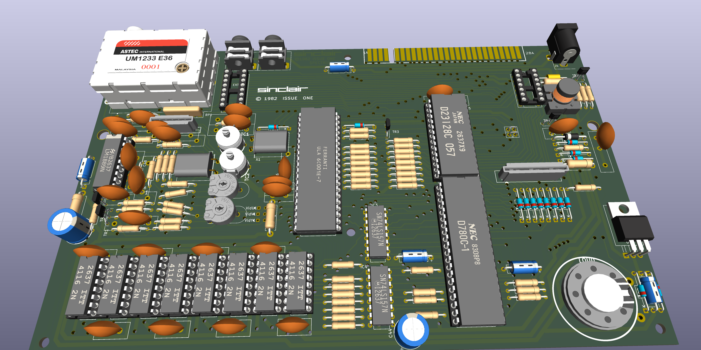
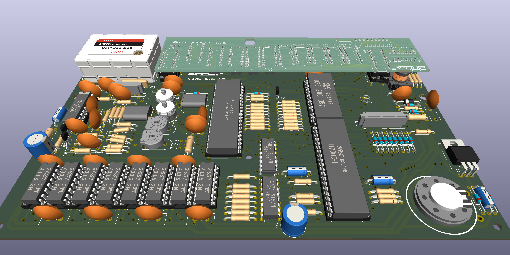

This is a Kicad 10 project and was only used to create an ibom to assist in the debugging of faulty boards. Use at your own risk.

Kicad does not like handrawn tracks, it only like straight lines so I have followed the route for each track but it does not track exactly but close enough for the user to find the track when debugging.

As such, if a topside track on the original PCB went between two pins of an IC, it still goes between the same two pins on the topside. If the track was between two other tracks it still is between the same two tracks, just not with the same curves. 

The ZX Spectrum Issue 1 raw PCB used has a silkscreen FAB revision of SRC089, a topside FAB revision of SRC076 A and a solder side FAB revision of SRC077 B.

The created schematic was based on the physical layout of that raw PCB with known components from a populated ZX Spectrum Issue 1 of the same silkscreen revision along with assistance from a ZX Spectrum Issue 2 schematic. Where there were differences the PCB layout took preference. Some of the component values might not be correct as I cannot find a proper BOM for an Issue 1.

Only those components that have footprints on the original PCB are included in the ibom as fitted. Any components that were in the Issue 2 schematic that do not have footprints are marked as No-Fit on the schematic. 

The 'Dead Cockroach' and 'Spider' mods are not shown as they are dependant on the ULA that is fitted.

Even though Kicad's DRC reports no critical errors I still would not use these gerbers to manufacture a PCB without a lot more checking.

The following modifications are listed in World Of Spectrum.org

Issue 1 Modifications

(1) When National 4116 RAM i.c.s are fitted, remove R57 (330ohm) - connected to pin 28 of IC2 - and fit a lkohm resistor between the CAS line and the 12v rail and another 1kohm resistor between the RAS line and the 12v rail. These resistors are best fitted on the underside of one of the memory chips IC6-13. C54 (at pin 3 of IC2) can also be removed - but it must be left in circuit when the 4116 RAMs are of NEC manufacture.

(2) When a type 5C102 ULA is fitted. add a 100pF capacitor between the RAS line and chassis.

(3) C46 (1uF electrolytic) should be replaced with a high-temperature capacitor it' s mounted beneath the heatsink.

(4) Axial capacitors should be fitted in place of all the disc ceramic capacitors. The following capacitors must he replaced: C41 (ROM pin 14 to pin 28) and C49 (between the collector and emitter of TR4) - these capacitors are both 47nF.

(5) If there' s insufficient colour difference between white and yellow, fit a 47kohm resistor between pin 13 of IC14 (LM1889) and chassis.

(6) To improve the reliability of the voltage generator the circuit should be modified to correspond with Fig. 13. A minimum would be to change the value of R60 and fit a 4.7uF electrolytic (C74) between the emitter and base of TR5. See the notes on this section of the circuit in Part 6 next month.

(7) Finally, if you want to use the Spectrum to operate a Z80 PIO, or if you find that some machine code software doesn' t run satisfactorily, check that the following modifications have been made.

(a) Change TR3s base circuit as shown in Fig 10. i.e. replace D14 with C67, change R24 to Ikohm and add the pull-up resistor R73.

(b) Change R27 from 680ohm to 47oohm or shunt it with a I.5kohm resistor (ULA pin 33 to CPU pin 20).

Have fun.